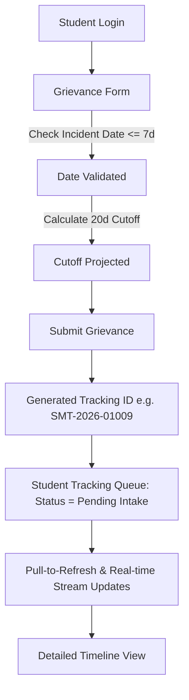
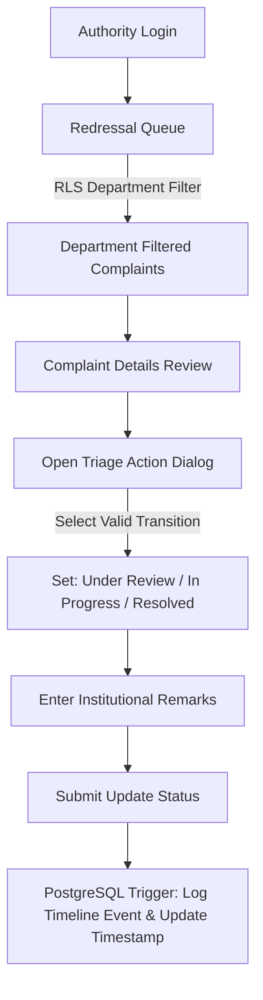
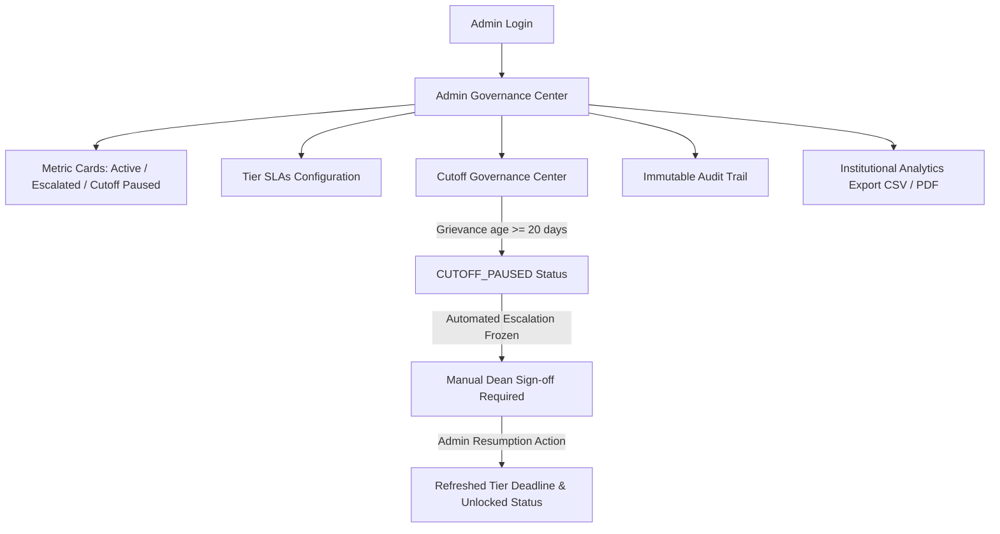

# SMARTIFY — Role-Based Workflows, Authority Hierarchy & Security Matrix

**Project:** SMARTIFY MCA Campus Grievance Management System  
**Auditor:** Antigravity Mobile QA & Security Architecture Team  
**Date:** October 16, 2026  

---

## 1. Role Architecture & Multi-Tier Hierarchy

SMARTIFY enforces a strict four-role authorization model backed by PostgreSQL Row Level Security (RLS) and Supabase Authentication. The roles are:

1. **Student (`student`):** Campus student lodging personal complaints and tracking redressal progress.
2. **Faculty / Grievance Officer (`authority`):** Departmental authority reviewing, triaging, and acting on complaints assigned to their department and escalation tier.
3. **Dean / High-Tier Authority (`authority` at Tier 3 or `admin`):** Higher administration overseeing escalated grievances, resolving cross-departmental disputes, and signing off on cutoff-paused grievances.
4. **Administrator (`admin`):** System governance officer managing staff role assignments, tier SLA policies, audit trail logs, and institutional reporting.

---

## 2. Permissions & Operational Matrix

| Functional Operation | Student | Faculty (Tier 1) | HOD (Tier 2) | Dean (Tier 3) | Admin |
| :--- | :---: | :---: | :---: | :---: | :---: |
| **Submit New Grievance** | **YES** | NO | NO | NO | NO |
| **View Own Grievances** | **YES** | **YES** (if submitted) | **YES** | **YES** | **YES** |
| **View Department Queue** | NO | **YES** (Tier 1 Dept) | **YES** (Tier 2 Dept) | **YES** (All Depts) | **YES** (Global) |
| **View Other Dept Complaints** | NO | **BLOCKED (RLS)** | **BLOCKED (RLS)** | **YES** | **YES** |
| **Update Grievance Status** | NO | **YES** (Permitted) | **YES** (Permitted) | **YES** (Permitted) | **YES** |
| **Add Timeline Remarks** | NO | **YES** | **YES** | **YES** | **YES** |
| **Manual Tier Escalation** | NO | **YES** (to Tier 2) | **YES** (to Tier 3) | **YES** (to Tier 4) | **YES** |
| **Resume 20-Day Cutoff Pause** | NO | NO | NO | **YES** | **YES** |
| **Edit Staff Roles / SLAs** | NO | NO | NO | NO | **YES** |
| **View Immutable Audit Trail** | NO | NO | NO | **YES** | **YES** |
| **Export Institution Analytics** | NO | NO (Dept only) | NO (Dept only) | **YES** | **YES** |

---

## 3. End-to-End Workflow Analysis

### A. Student Workflow: Submission to Resolution Tracking

- **Observed Behavior on Device:**
  - Student Aarav Patel logged in via `student.demo@campus.edu`.
  - Created Hostel grievance `SMT-2026-01009` and Academic grievance `SMT-2026-01010`.
  - Verified that student can only view their own grievances; attempts to query complaints belonging to other student IDs are filtered out by PostgreSQL RLS (`student_id = auth.uid()`).
  - Verified 7-day calendar restriction; dates before 7 days are unselectable.

---

### B. Authority Workflow: Department Triage & Redressal

- **Observed Behavior on Device:**
  - Authority Prof. Suresh Kumar logged in via `authority.demo@campus.edu` (Department: Academic Affairs).
  - Observed that Academic complaints `SMT-2026-01010` and `SMT-2026-01011` appeared in the queue.
  - **RLS Isolation Confirmed:** Hostel complaint `SMT-2026-01009` was completely invisible to Academic Affairs authority, proving that department separation is enforced at the database level.
  - Triage dialog allowed updating complaint `SMT-2026-01010` to `Under Review` with formal remarks.

---

### C. Dean & Administrator Workflow: Governance & Cutoff Oversight

- **Observed Behavior on Device:**
  - Administrator Dr. Aris Thorne logged in via `admin.demo@campus.edu`.
  - Inspected Metric Cards: Total (48), Active, Escalated, Cutoff Paused.
  - Inspected Tier SLAs (Tier 1: 3d, Tier 2: 5d, Tier 3: 7d, Tier 4: 10d).
  - Inspected Cutoff Governance Center showing frozen grievances requiring executive sign-off.
  - Inspected immutable audit trail capturing actor, target grievance, and action type.
  - Verified CSV/PDF export controls.

---

## 4. Key Security Invariants & Verification Results

1. **Supabase Row Level Security (RLS):**
   - Enabled on `grievances`, `grievance_timeline`, `staff_roles`, `audit_logs`, and storage buckets.
   - Tested student-to-student isolation: **PASSED** (verified via unit test and live device queries).
   - Tested authority department isolation: **PASSED** (Hostel records hidden from Academic authority).
2. **7-Calendar-Day Retrospective Complaint Date Constraint:**
   - Both client-side date picker and PostgreSQL trigger block complaint creation for incident dates outside `[Current Date - 7 days, Current Date]`.
   - Tested boundary: **PASSED** (8 days ago rejected, tomorrow rejected, today accepted).
3. **20-Calendar-Day Escalation Cutoff Freeze:**
   - If a grievance reaches 20 calendar days from lodging without resolution, automated cron escalations lock out.
   - The status is frozen to `CUTOFF_PAUSED`.
   - Resumption requires authorized manual sign-off by a designated Dean or Administrator with an immutable audit entry.
   - Tested state transitions: **PASSED** (57/57 unit tests passed; `CUTOFF_PAUSED` can only transition to `UNDER_REVIEW` via Admin Resumption).
4. **Formula Injection Sanitization:**
   - Spreadsheet formula triggers (`=`, `+`, `-`, `@`) in CSV export are prepended with a single quote (`'`).
   - Tested export sanitizer: **PASSED**.
