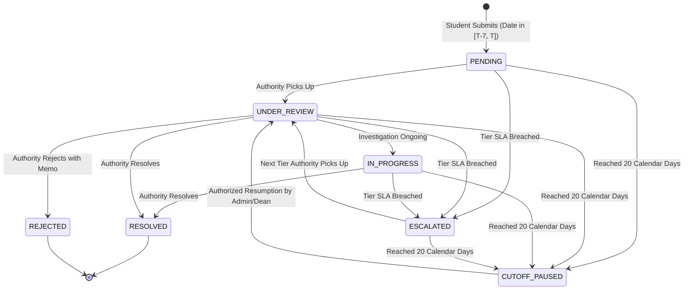

# SMARTIFY — Software Architecture Document

---

## 1. Architectural Style & Principles

SMARTIFY uses a **Feature-First Layered Architecture** with unidirectional data flow powered by **Provider**:

```
UI Layer (Screens & Widgets)
       ↓ (Dispatches UI intents / Listens to state)
Domain / State Layer (ChangeNotifier Providers)
       ↓ (Executes business rules & validates input)
Data Layer (Repositories & Remote Data Sources)
       ↓ (Queries Supabase REST / Storage SDK)
PostgreSQL Database & Storage Buckets (Protected by RLS)
```

### Module Responsibilities & Dependency Rules
1. **Presentation Layer (`screens/`, `widgets/`):**
   * Responsible solely for rendering UI, consuming theme tokens, reacting to provider states, and dispatching user actions.
   * Never makes direct network calls or queries Supabase directly.
2. **Domain/State Layer (`providers/`):**
   * Manages view state (`idle`, `loading`, `error`, `success`).
   * Validates user inputs before passing to repositories.
   * Implements state machines (e.g., complaint status transitions).
3. **Data Layer (`services/`, `repositories/`, `models/`):**
   * Encapsulates all interactions with Supabase (Auth, PostgreSQL queries, Storage file uploads).
   * Maps raw JSON responses to strongly typed Dart models with sound null safety.
   * Maps backend exceptions into typed `Failure` objects.

---

## 2. User Experiences & Role Workflows

### A. Student Experience
* **Authentication:** Registration with Student ID / Roll Number and Email. Assigned role `'student'` by default.
* **Grievance Submission:**
  * Categorized selection (Academic, Hostel, Infrastructure, Finance, IT).
  * Incident date selection constrained to `[Today - 7 days, Today]`.
  * Multi-file attachment upload (images, PDFs) with client-side file compression and validation.
* **Tracking & History:**
  * Real-time status cards showing current authority level and pending SLA countdown.
  * Interactive vertical timeline showing every review, remark, and escalation.
* **Notifications:** In-app alerts when status changes or authority provides remarks.

### B. Authority Experience (Wardens, HoDs, Deans)
* **Intake Dashboard:** Queue of grievances filtered by authority's assigned department and current hierarchy level.
* **Action Handlers:**
  * *Under Review:* Mark as picked up.
  * *Resolve:* Provide resolution notes and resolve issue.
  * *Reject:* Provide validated rejection memo.
  * *Manual Escalation:* Forward to higher level with explanation.

### C. Admin Experience (Campus Ombudsman / Principal)
* **Campus Oversight Dashboard:** Cross-department metrics, SLA breach rates, turnaround trends (`fl_chart`).
* **Resumption Authorization:** Review grievances paused under the 20-day cutoff, provide formal sign-off, and resume case handling.
* **Audit Inspector:** Filter append-only audit logs across security and grievance actions.
* **Report Generation:** Download comprehensive PDF grievance summaries and CSV audit exports.

---

## 3. Complaint Lifecycle & Escalation Architecture



### Hierarchy Tiers & Deadlines
* **Level 1:** Faculty Advisor / Hostel Warden (`SLA: 3 calendar days`)
* **Level 2:** Head of Department (`SLA: 4 calendar days`)
* **Level 3:** Dean of Student Welfare / Grievance Cell (`SLA: 5 calendar days`)
* **Level 4:** Campus Ombudsman / Principal Board (`SLA: 5 calendar days`)

### 20-Calendar-Day Cutoff Freeze
* At `created_at + INTERVAL '20 days'`, any unresolved grievance automatically freezes (`status = 'CUTOFF_PAUSED'`).
* Scheduled automated escalations are locked out.
* Resumption requires authorized manual sign-off by an Administrator or Dean via `resume_paused_complaint()`, recording an immutable audit record.

---

## 4. Database Migrations & Environment Architecture

* **Migrations:** Maintained sequentially in `supabase/migrations/` using timestamped naming (`YYYYMMDDHHMMSS_<name>.sql`).
* **Environment Configuration:**
  * Public config (`SUPABASE_URL`, `SUPABASE_ANON_KEY`) supplied to the Flutter client via compile-time `--dart-define` or local `.env`.
  * Privileged connection strings (`DATABASE_URL`, `SUPABASE_SERVICE_ROLE_KEY`) are kept strictly off the mobile client and stored only in server-side/local development tooling.
